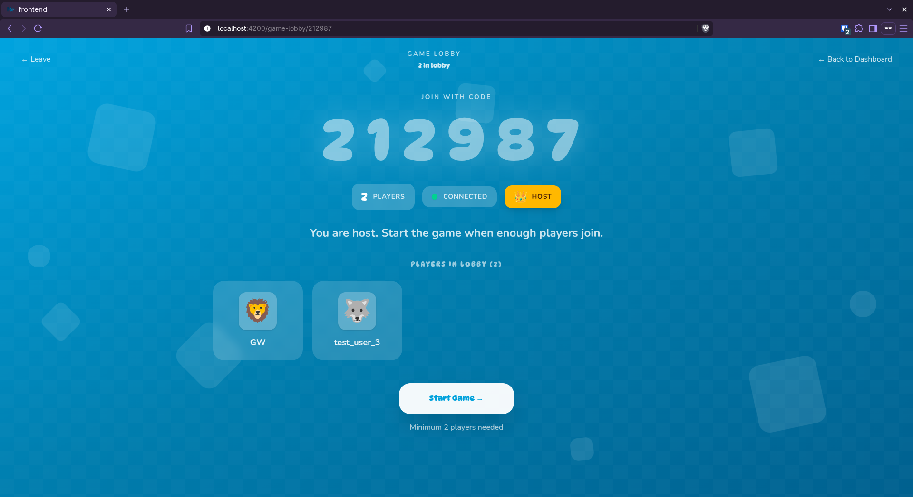
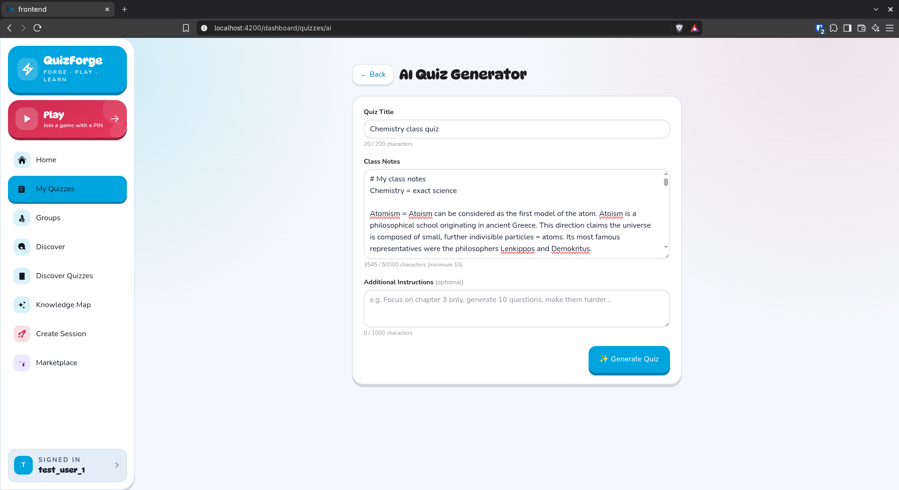
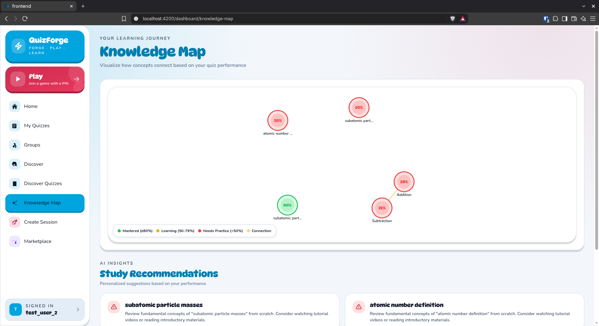
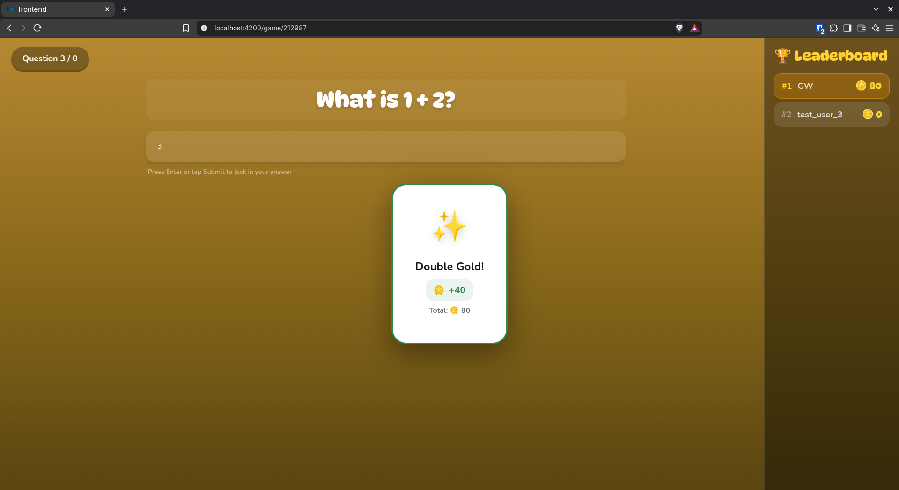
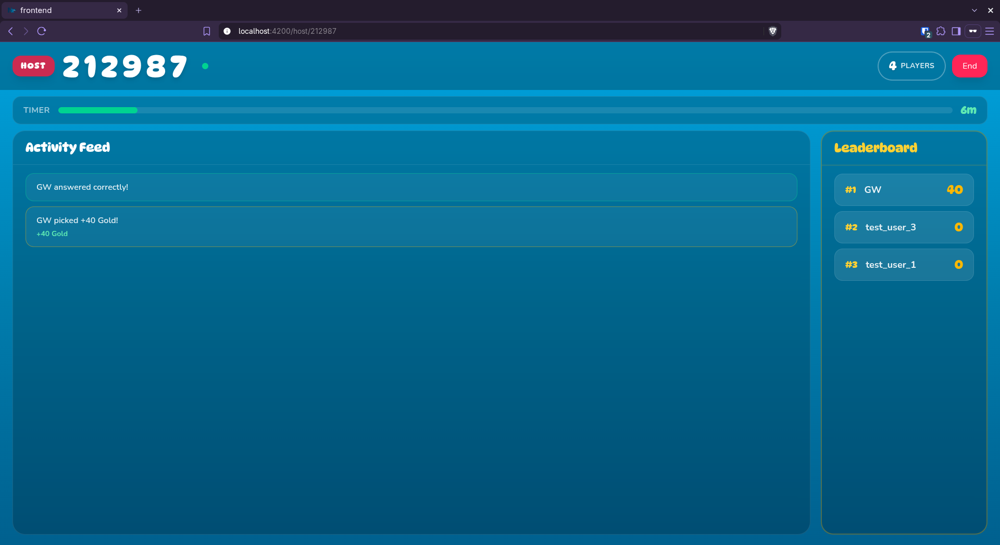
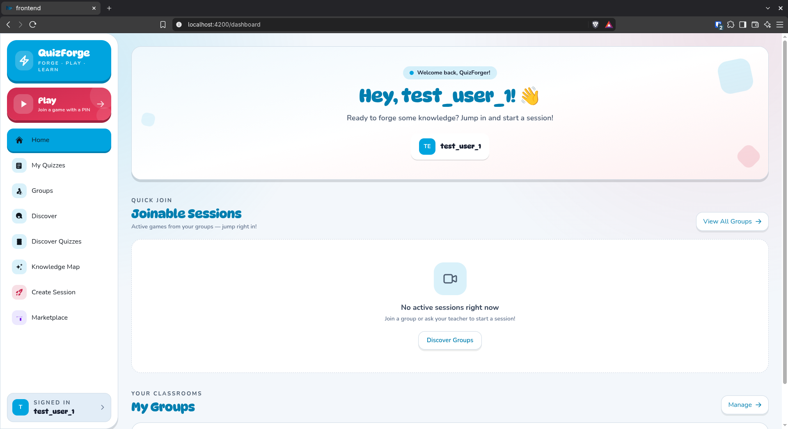
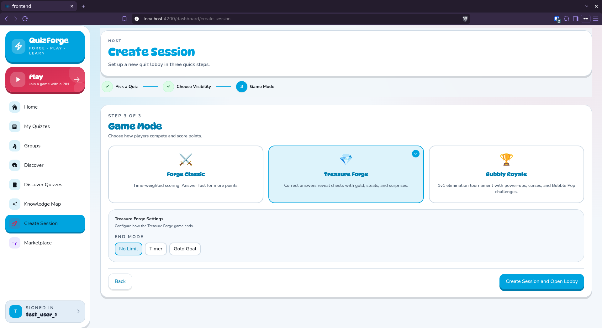
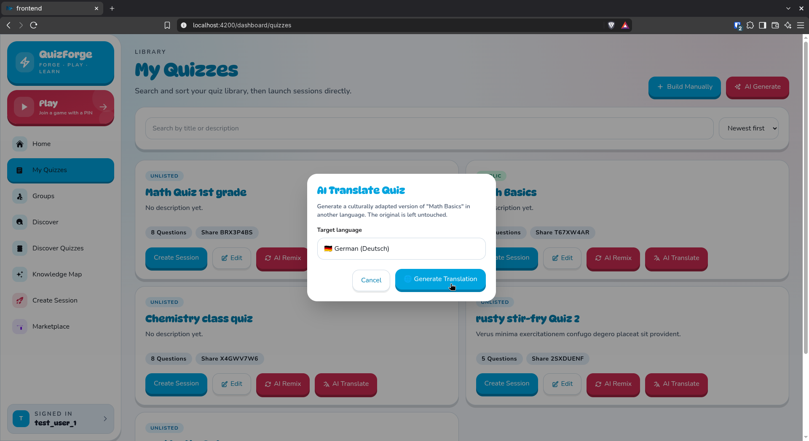
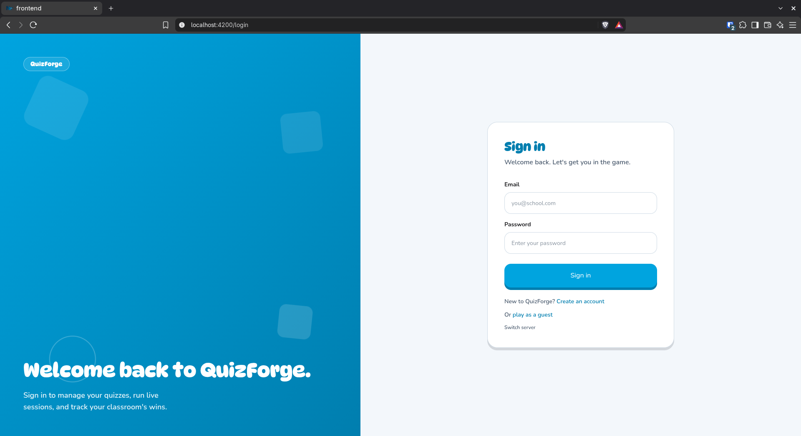

# QuizForge

**Forge. Play. Learn.**

A multiplayer quiz platform that turns learning into friendly competition. 
Create a quiz, share a game PIN, and bring your classroom or friends together.

[Team](#team) · [Features](#features) · [Game modes](#game-modes) · [Screenshots](#screenshots) · [Tech stack](#tech-stack)

## Team

Created as a school project at **HTL Leonding · 2025/26** by:

[Mohamad Abdulwahid](https://github.com/MohamadAbdulwahid) ·
[Nishan Chhantyal](https://github.com/Nishan277) ·
[Behrang Elyasi](https://github.com/BehrangEl11) ·
[David Zwettler](https://github.com/Jimmy0rban)

## Features

- **Play together, live.** PIN-based lobbies, host controls, and real-time leaderboards.
- **Build quizzes your way.** Multiple choice, true/false, ordering, matching, and fill-in-the-blank questions.
- **Turn notes into quizzes.** AI-assisted question generation and quiz translation.
- **Learn beyond the scoreboard.** A personal knowledge map highlights strengths and topics to practise.
- **Bring your class together.** Public or private groups, member invitations, and sessions shared with your class.

## Game modes

| Mode | The twist |
| --- | --- |
| **Forge Classic** | Race to answer correctly. Speed earns bonus points. |
| **Treasure Forge** | Open chests, steal or swap gold, and turn the leaderboard upside down. |
| **Bubbly Royale** | Face off in duels, protect your lives, and be the last player standing. |

## Screenshots

| Create quizzes from your notes | See what to practise next |
| :---: | :---: |
|  |  |
| **Play for gold** | **Follow the action as host** |
|  |  |

More of QuizForge

**Your dashboard**

**Set up a session**

**Translate a quiz**

**Welcome aboard**

## Tech stack

Built end to end in **TypeScript**, with a custom, playful interface we call *Bubbly Minimalism*.

| Layer | Technologies |
| --- | --- |
| Frontend | Angular 21, Signals, Tailwind CSS, DaisyUI |
| Backend & real-time | Bun, Express, Socket.IO |
| Database & authentication | PostgreSQL, Supabase Auth, Drizzle ORM |
| Testing | Vitest, Angular Testing Library, Bun test, Playwright |
| Workspace | Nx monorepo, shared TypeScript models |

Scoring is validated on the server, and reconnect recovery keeps players in the game after brief disconnects.

Explore the [project documentation](docs), [database design](docs/erd.png), and [performance decisions](docs/performance.md).

---

Open source under the [AGPL-3.0 license](LICENSE).
